<p align="center">
  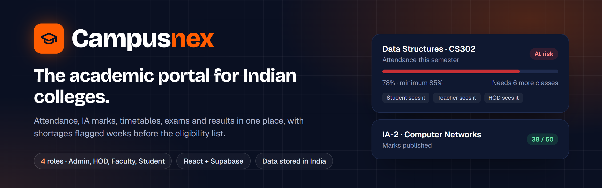
</p>

<p align="center">
  <a href="https://campusnex.amarsai.in"></a>
  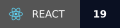
  
  
  
  
</p>

<p align="center">
  <b><a href="https://campusnex.amarsai.in">Live site</a></b> ·
  <a href="#what-each-role-can-do">Features</a> ·
  <a href="#screenshots">Screenshots</a> ·
  <a href="#architecture">Architecture</a> ·
  <a href="#how-it-works">Workflows</a> ·
  <a href="#run-it-locally">Run locally</a>
</p>

---

## Why Campusnex

Every semester, some students learn about an attendance shortage only when the eligibility list goes up, and by then nothing can be fixed. Campusnex keeps attendance, IA marks, timetables, exams and results in one place, so **the student, the subject teacher and the HOD all see a shortage weeks earlier**, while there is still time to act.

It is built for engineering, degree and diploma colleges and adapts to each college's rules: minimum attendance (75%, 85% or your own), grading scale, student IDs (USN, roll or register number) and exam pattern (CIE and SEE, or internals and externals).

## What each role can do

| Role | Highlights |
|---|---|
| **Admin** | Departments, courses and users (with bulk import) · timetable builder with a change log · lab batches · semester calendar and events · exam timetable, rooms and seating plans · result import and publishing · announcements · institution analytics · activity log |
| **HOD** | Department overview · class analytics · faculty compliance (attendance and marks entry) · manages the department's students · sees at-risk students early, including unpublished marks |
| **Faculty** | Takes attendance by class session · enters IA marks · assignments with files · class sheets · course announcements · class and student analytics · personal timetable |
| **Student** | One hub for attendance, IA marks and results · attendance planner ("how many classes can I miss?") · timetable and calendar · assignment submission · exam seat · anonymous course feedback · requests and grievances · faculty directory |

**At-risk rules** ([`src/utils/risk.js`](src/utils/risk.js)): attendance below 85% is *at risk* and below 90% is a *warning*, judged only after at least 4 classes. Marks below 40% are *at risk* and below 50% a *warning*.

## Screenshots

<table>
  <tr>
    <td width="33%">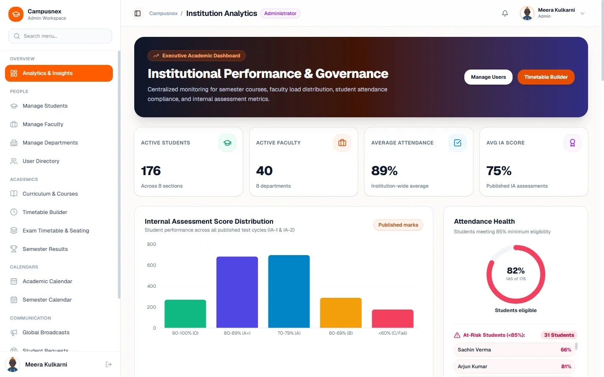<br><sub><b>Admin</b> · Institution analytics</sub></td>
    <td width="33%">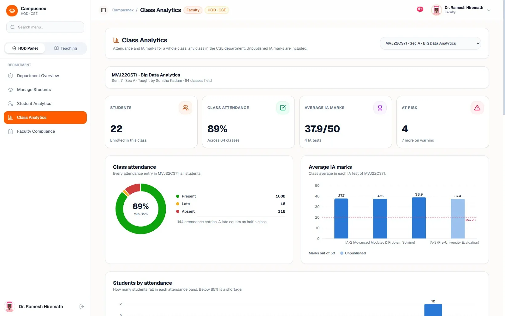<br><sub><b>HOD</b> · Class analytics</sub></td>
    <td width="33%">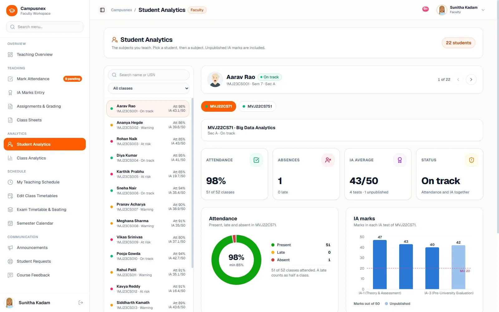<br><sub><b>Faculty</b> · Student analytics</sub></td>
  </tr>
  <tr>
    <td colspan="1">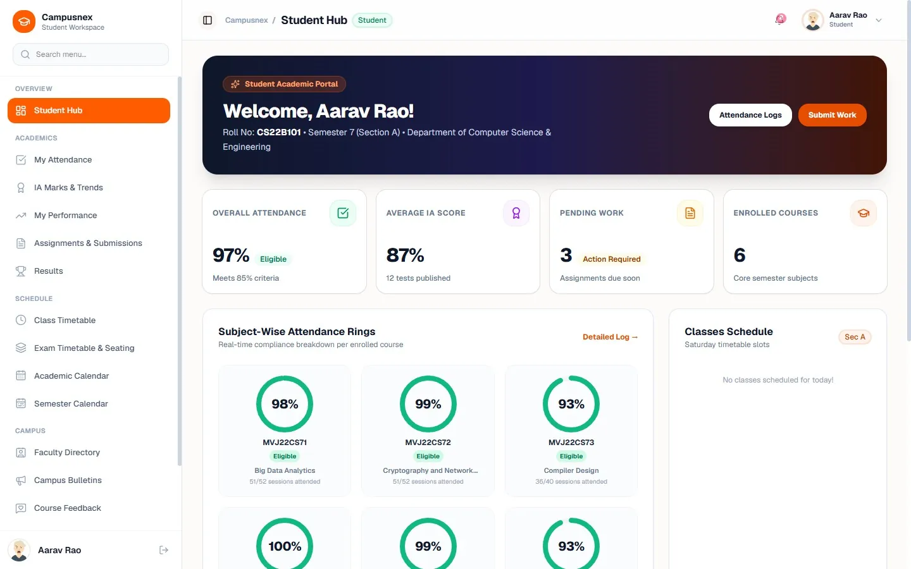<br><sub><b>Student</b> · Attendance and IA marks</sub></td>
    <td colspan="2">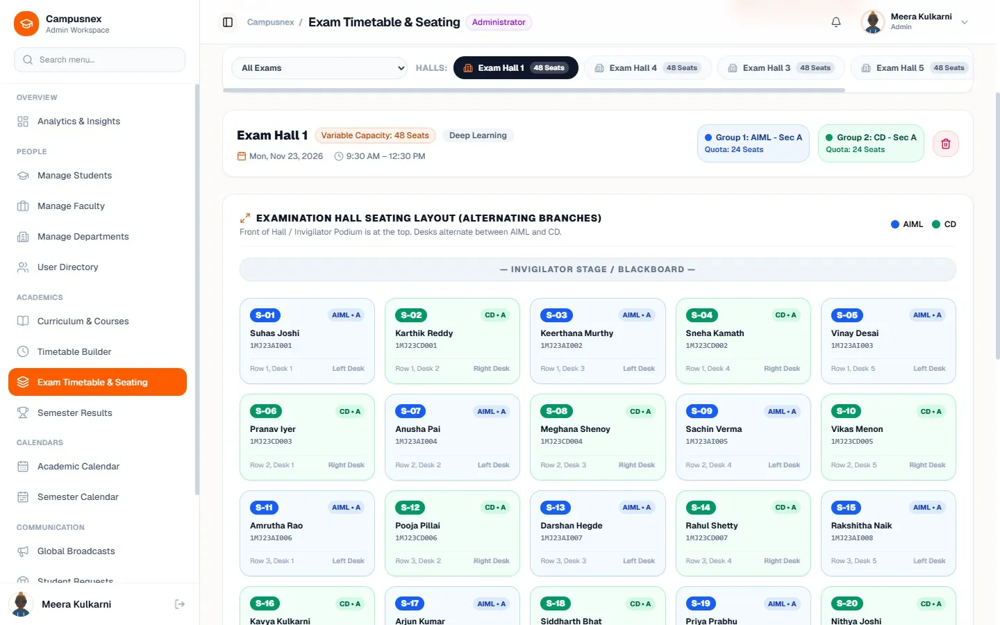<br><sub><b>Admin</b> · Exam seating plan</sub></td>
  </tr>
</table>

<sub>Screenshots use test data.</sub>

## Architecture

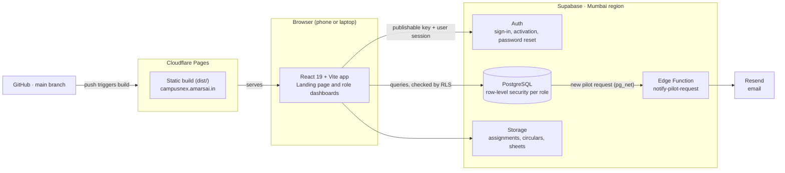

- **No custom server.** The browser talks to Supabase directly with the publishable key; **row-level security in the database** decides what each signed-in role can read and change, so the browser never has more access than its user.
- **Data stays in India** (Supabase, Mumbai region) and every connection is encrypted.
- **Deploys are automatic:** each push to `main` is built and published by Cloudflare Pages.

## How it works

### From attendance to an early warning

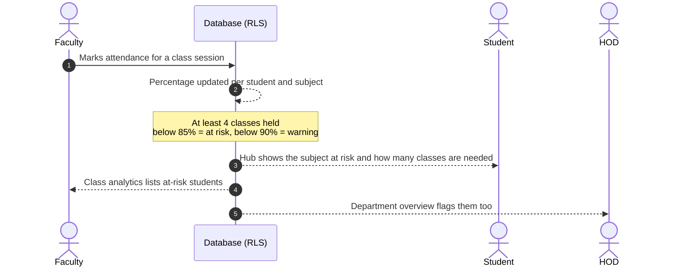

### How accounts are created (no public sign-up)

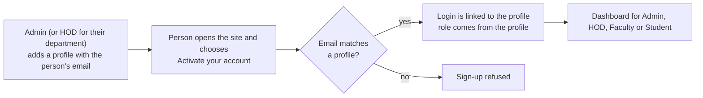

### Pilot requests from the landing page

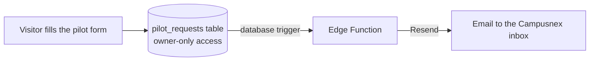

## Tech stack

| Layer | Tools |
|---|---|
| Frontend | React 19, Vite 8, Tailwind CSS 4, shadcn/ui on Radix, Motion (framer-motion), Recharts, Lenis, lucide-react |
| Backend | Supabase: PostgreSQL with row-level security, Auth, Storage, Edge Functions (Deno), pg_net |
| Email | Resend |
| Hosting | Cloudflare Pages (custom domain, HTTPS) |

## Project structure

```text
src/
  views/            pages: landing, auth, admin, faculty, student
  components/
    admin/          departments, users, timetable, results, analytics
    hod/            department overview, faculty compliance
    faculty/        attendance, IA marks, assignments, class analytics
    student/        hub, attendance planner, results, feedback, requests
    exams/          exam timetable, rooms, seating plans
    ui/             shared shadcn/ui components
  context/          AuthContext (session), DataContext (data loading)
  utils/            risk rules, eligibility, timetable conflicts, reports
  lib/              Supabase client and helpers
supabase/
  migrations/       schema and row-level security, applied in order
  functions/        notify-pilot-request (Edge Function)
public/screens/     screenshots used on the landing page and here
```

## Run it locally

You need Node.js 20.19 or newer and a Supabase project.

```bash
git clone https://github.com/AmarSai01/campusnex.git
cd campusnex
npm install
cp .env.example .env.local   # then fill in your Supabase URL and publishable key
npm run dev                  # http://localhost:5173
```

Set up the database by running the files in [`supabase/migrations`](supabase/migrations) in order, then follow [`supabase/README.md`](supabase/README.md) to create the first admin account.

| Command | What it does |
|---|---|
| `npm run dev` | Start the dev server |
| `npm run build` | Production build into `dist/` |
| `npm run preview` | Serve the production build locally |

## Security and privacy

- Access rules live in the database, not only in the interface: each role sees only its own college data.
- Sign-up works only for emails an admin has already added, so there is no open registration.
- Secrets (the Supabase service key, the Resend key) live in Supabase's secret settings, never in this repository.
- The full privacy policy is on the [live site](https://campusnex.amarsai.in) (footer → Privacy policy).

## Contact

Built by **Amar Sai** (Amareshwar Thuraka), Bengaluru.

[LinkedIn](https://www.linkedin.com/in/amareshwar9347) · [GitHub](https://github.com/AmarSai01) · campusnex.official@gmail.com

Want to try Campusnex with one department? Use **Request a pilot** on the [live site](https://campusnex.amarsai.in).

## License

Copyright © 2026 Amar Sai. All rights reserved. The code is public to read; it may not be copied, modified or used to run another service without written permission.
